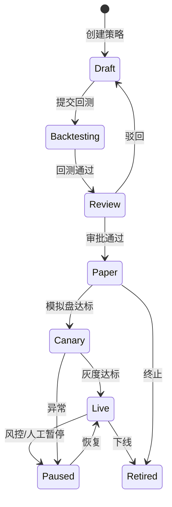
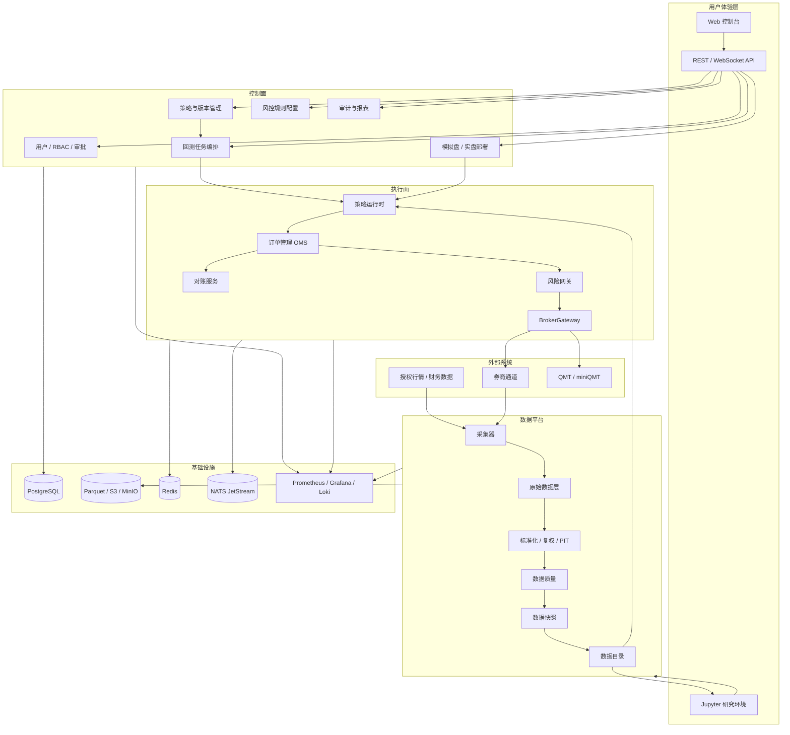
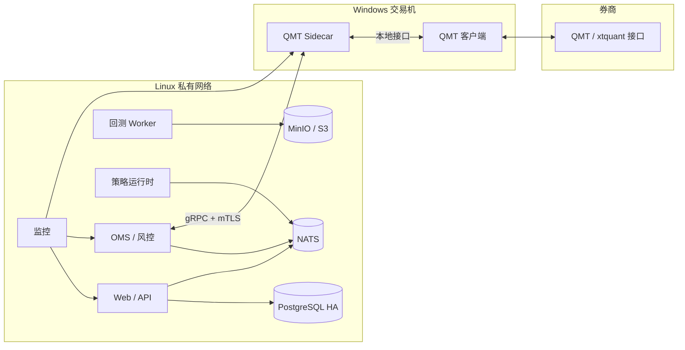
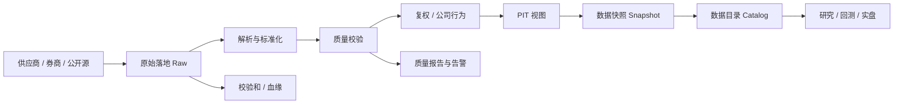
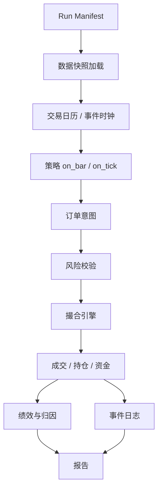
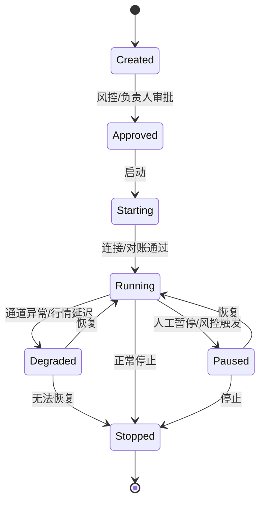
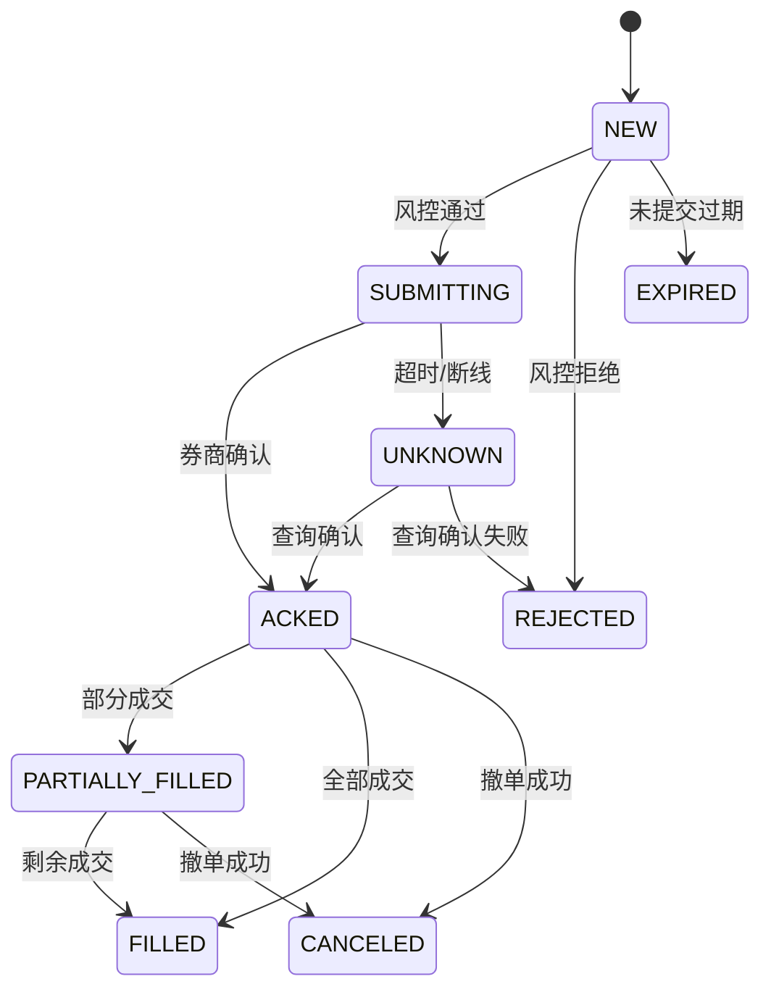
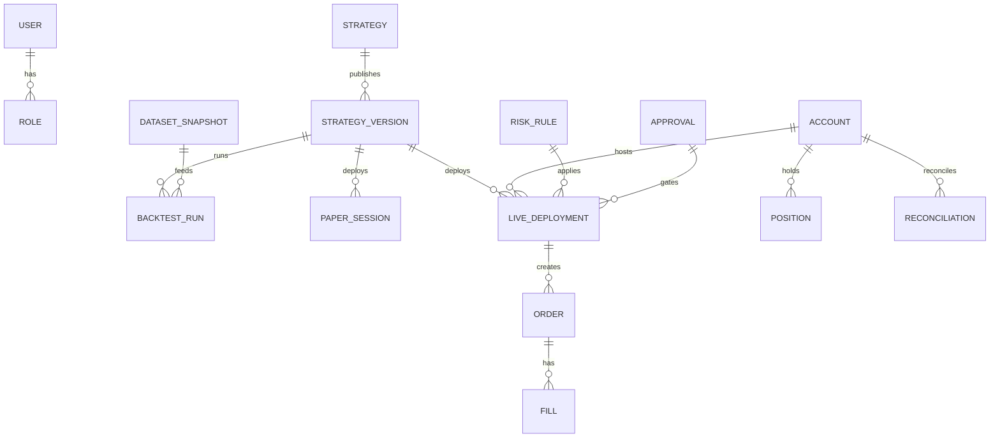

# 量化交易系统产品技术实现方案

| 项目 | 内容 |
| --- | --- |
| 文档版本 | v0.1（调研与方案稿） |
| 日期 | 2026-11-05 |
| 适用范围 | A 股股票为主，日线/分钟线优先，非高频，小团队自营或内部研究 |
| 文档状态 | 待产品、量化、交易、合规联合评审 |
| 结论摘要 | 不直接 fork 单一开源项目，采用“自研薄控制面 + 统一策略 API + 标准化 BrokerGateway”的组合路线 |

> 免责声明：本文是技术方案，不构成投资建议、法律意见或券商接口开通承诺。数据授权、行情再分发、券商 API 权限、资产管理/投顾资质等事项必须由法务与合规单独确认。文中涉及的开源项目版本、许可证、功能边界与券商接口能力，应以官方仓库、官方文档及实际开户券商的最新说明为准。本文在受限网络环境下完成，部分资料来自公开检索，未逐页核验官方 README。

---

## 1. 执行摘要

### 1.1 核心判断

量化交易系统并不是“回测框架 + 券商 API”的简单拼接。一个可长期运行的系统至少包含五条相互约束的链路：

1. **数据链路**：采集、清洗、复权、交易日历、停牌/ST/退市、指数成分、财务数据的 point-in-time 管理。
2. **研究链路**：因子计算、模型训练、参数搜索、回测、归因与实验管理。
3. **交易链路**：策略实例、订单管理、风控、券商网关、成交回报、持仓与资金。
4. **运维链路**：部署、监控、告警、对账、灾备、审计与权限。
5. **合规链路**：数据授权、接口授权、账户权限、交易行为留痕与适当性管理。

调研后没有发现一个开源项目可以同时满足“A 股数据 + 研究回测 + 国内券商实盘 + 生产级风控运维”。因此建议：

> **自研一层薄而完整的控制面，复用开源项目的研究/回测思想与国内交易网关生态，通过统一策略 API 和 BrokerGateway 隔离引擎、数据源和券商。**

### 1.2 推荐路线

| 层次 | 推荐做法 | 不推荐做法 |
| --- | --- | --- |
| 数据 | 自建标准化数据平台；生产数据采购授权源；开源数据仅用于原型 | 直接把爬虫数据当生产行情 |
| 研究 | 自研因子/回测 API；可选集成 Qlib、Polars、DuckDB | 把 Qlib 直接当交易系统 |
| 回测 | 事件驱动内核 + 向量化因子预处理；A 股规则内置且可配置 | 只用简单 bar 撮合，不考虑涨跌停/T+1/停牌 |
| 实盘 | 统一 OMS + 风控网关 + BrokerGateway；首期接 QMT/miniQMT sidecar | 策略直接调用券商 SDK |
| 部署 | 模块化单体起步，数据 worker、策略 runner、网关 sidecar 独立进程 | 一开始就拆十几个微服务 |
| 运维 | 全链路事件日志、订单幂等、日终对账、kill switch | 只看策略收益率，不做交易一致性 |

### 1.3 首期产品边界

首期建议只做以下范围，避免“大而全”导致无法上线：

- 市场：A 股股票（沪深主板、创业板、科创板、北交所可按需裁剪），不含期权、期货、外汇。
- 频率：日线、分钟线；tick 级作为 P3 能力。
- 策略：中低频选股、择时、轮动、指数增强；不做低延迟/HFT。
- 账户：单券商、单资金账户、多策略实例；P2 再扩展多账户。
- 交易：先模拟盘，再小资金灰度，最后实盘；所有订单经过统一风控。
- 用户：内部量化团队/自营团队，暂不对公众提供投顾或代客理财。

### 1.4 首期成功标准

- 同一份策略代码可在回测、模拟盘、实盘三种模式运行，差异只来自配置与适配器。
- 任一回测可由“数据快照 + 代码 commit + 配置 + 随机种子”复现。
- 模拟盘与实盘的信号一致率达到可解释水平，订单不重复、不丢失。
- 日终订单、成交、持仓、资金对账零差异；异常时有可执行的熔断与人工接管流程。
- 数据质量问题在进入策略前被拦截，而不是在交易后才发现。

---

## 2. 调研范围与方法

### 2.1 调研对象

本次重点调研以下开源项目：

- Microsoft Qlib
- QuantConnect LEAN
- NautilusTrader
- vn.py（VeighNa）
- RQAlpha
- WonderTrader
- QUANTAXIS
- Backtrader
- Zipline-reloaded
- Freqtrade（作为加密交易机器人运维模式参考）

同时参考国内常见数据源与通道：AkShare、Tushare、BaoStock、RQData、JQData、Wind/Choice/iFinD 等授权数据，以及 QMT/miniQMT、XTP、OST 等券商通道。

### 2.2 评估维度

| 维度 | 关注问题 |
| --- | --- |
| 定位 | 研究平台、回测框架、交易引擎还是完整交易系统 |
| 数据 | 是否自带数据、是否支持本地数据、是否支持 point-in-time |
| 回测 | 事件驱动/向量化、撮合真实度、成本模型、A 股规则 |
| 实盘 | 是否有生产级 OMS、券商适配器、断线恢复、对账 |
| A 股适配 | T+1、涨跌停、停牌、ST、整手、复权、交易时段 |
| 扩展性 | 新增数据源、券商、策略、资产的成本 |
| 运维 | 部署复杂度、可观测性、故障恢复、团队技能要求 |
| 许可证 | 是否允许闭源商用、动态链接/分发义务、商业授权条款 |
| 社区与维护 | 更新频率、文档、issue 响应、国内生态 |

### 2.3 调研限制

开源项目的功能与许可证会随版本变化。本文中的判断用于架构选型，不替代以下动作：

- 对目标版本拉取 `LICENSE`、`NOTICE`、依赖树做法律扫描。
- 对目标券商确认 QMT/miniQMT、XTP 等接口的开通条件、权限与稳定性。
- 对数据供应商确认授权范围、历史深度、字段口径、再分发限制。

---

## 3. 开源项目横向对比

### 3.1 总览矩阵

> 许可证列仅作技术选型提示，最终以官方仓库 LICENSE 与法务意见为准。

| 项目 | 主语言 | 许可证（需复核） | 核心定位 | 数据能力 | 回测能力 | 实盘能力 | A 股适配 | 主要借鉴点 |
| --- | --- | --- | --- | --- | --- | --- | --- | --- |
| Qlib | Python | MIT | AI 量化研究平台 | 数据 handler、本地数据 | 强，研究导向 | 无生产实盘 | 中，需要自建数据与规则 | 因子/模型/实验管理、表达式引擎 |
| LEAN | C# + Python | Apache-2.0 | 多资产算法交易引擎 | 订阅制数据、本地数据 | 强 | 强，海外券商适配多 | 弱 | 回测/实盘同构、事件驱动、组合模型 |
| NautilusTrader | Rust + Python | LGPL-3.0（版本差异需复核） | 高性能事件驱动交易引擎 | 适配器 + Parquet catalog | 强 | 强，加密/期货/外汇为主 | 弱 | 消息总线、回测实盘一致性、执行语义 |
| vn.py | Python | Apache-2.0（需复核） | 国内交易终端与网关框架 | 数据录制、第三方数据 | 中 | 强，CTP/XTP/OST 等 | 强 | 网关抽象、事件引擎、国内生态 |
| RQAlpha | Python | Apache-2.0 + 商业授权（需复核） | A 股回测/模拟框架 | 数据 bundle、RQData | 强 | 有实盘框架，生产通道需扩展 | 强 | A 股规则、Mod 模块化、回测 API |
| WonderTrader | C++ + Python | MIT | 机构级一站式交易框架 | 数据清洗与本地伺服 | 强 | 强，多账户/多通道 | 强 | 高性能内核、组合盘、风控与调度 |
| QUANTAXIS | Python | MIT（需复核） | 全流程量化框架 | 中等 | 中等 | 有实盘扩展 | 中 | 数据/回测/实盘一体化产品思路 |
| Backtrader | Python | GPL-3.0 | 轻量回测框架 | 无 | 中 | 弱 | 弱 | 策略 API、分析器、社区示例 |
| Zipline-reloaded | Python | Apache-2.0 | 美股回测框架 | 无，自带 bundle 机制 | 强 | 无 | 弱 | Pipeline、交易日历、数据 bundle |
| Freqtrade | Python | GPL-3.0 | 加密货币交易机器人 | 交易所 API | 强 | 强 | 不适用 | 机器人运维、风控、通知、参数优化 |

### 3.2 逐项分析

#### 3.2.1 Microsoft Qlib

**定位**：面向 AI 的量化投资研究平台，覆盖数据、因子、模型训练、组合构建与回测。它的强项是“研究流水线”和“模型实验”，不是券商交易执行。

**优势**：

- 表达式因子引擎、数据集 handler、模型训练与回测流程较完整。
- 支持监督学习、强化学习、市场状态建模等研究范式。
- 实验管理与可复现研究的设计值得借鉴。
- MIT 许可证对商业产品友好。

**局限**：

- 不提供生产级 OMS、券商网关、资金/持仓对账与运维体系。
- A 股交易规则、停牌、涨跌停、ST、整手等需要自行补齐。
- 数据接入偏研究，生产数据授权与 point-in-time 治理仍需自建。
- 框架抽象较重，直接改造成交易系统会引入不必要的耦合。

**结论**：作为因子研究、模型训练和实验管理的参考或可选组件，不作为交易主框架。

#### 3.2.2 QuantConnect LEAN

**定位**：开源的多资产算法交易引擎，C# 内核、Python/C# 策略接口，回测、研究、实盘共用同一套事件模型。QuantConnect 云端平台即基于 LEAN。

**优势**：

- “一份策略代码，回测与实盘同构”的架构非常值得学习。
- 多资产模型、组合/持仓模型、订单事件、数据切片设计成熟。
- 支持多种海外券商与数据源，工程化程度高。
- Apache-2.0 许可证相对友好。

**局限**：

- C#/.NET 技术栈较重，团队需要额外维护 .NET 运行时与调试链路。
- 国内 A 股券商适配基本缺失，不能直接用于 QMT/XTP 实盘。
- A 股规则（T+1、涨跌停、ST、整手、集合竞价细节）不在其核心语义内。
- 数据授权、交易通道与合规仍需自行解决。

**结论**：作为事件驱动引擎、组合模型和回测/实盘同构架构的参考，不作为首期底座。

#### 3.2.3 NautilusTrader

**定位**：Rust 核心 + Python 控制面的生产级事件驱动交易平台，强调回测与实盘的行为一致性，面向多资产、多交易场所。

**优势**：

- 消息总线、缓存、执行引擎、风险引擎的分层清晰。
- 回测与实盘共享策略代码和执行语义，确定性较好。
- Rust 核心带来性能与内存安全优势，适合长期演进。
- 适配器模型清晰，便于新增交易场所。

**局限**：

- 核心适配器以加密、外汇、期货为主，A 股券商通道需要自研。
- LGPL 许可证在闭源分发、动态链接和修改后发布场景需要法务评估。
- 学习曲线较陡，团队需要理解其事件模型与对象体系。
- 版本迭代期间 API 可能变化，需要锁定版本并做升级评估。

**结论**：作为执行引擎架构、消息总线和回测/实盘一致性设计的重点参考；是否嵌入需通过许可证与团队能力评估。

#### 3.2.4 vn.py（VeighNa）

**定位**：国内使用广泛的 Python 量化交易框架，提供事件引擎、交易网关、策略应用、回测与 GUI 监控。

**优势**：

- 国内交易通道生态丰富，CTP、XTP、OST 等适配经验多；QMT 可通过社区网关或自研适配。
- Gateway 抽象、事件引擎、策略应用分层适合国内实盘场景。
- 中文文档与社区基础较好，问题排查成本低。
- 可快速验证券商通道与交易流程。

**局限**：

- 传统架构偏桌面端/单机，Web 化、多租户、权限、审计和云原生运维需要大量二次开发。
- 回测能力与专业研究平台相比偏轻，A 股细节需自行补齐。
- 不同网关质量参差，生产稳定性依赖具体通道与版本。
- 直接作为产品底座会受其 UI、配置和数据模型约束。

**结论**：作为国内券商网关、事件引擎和实盘接入的重要参考；首期可借鉴其 Gateway 设计，必要时复用具体通道 SDK 经验。

#### 3.2.5 RQAlpha

**定位**：米筐开源的 A 股回测与模拟框架，内置 T+1、涨跌停、停牌、ST、除权除息等规则，并提供实盘运行框架。

**优势**：

- A 股回测语义完整，适合验证中低频策略。
- Mod 机制便于扩展数据、风控、分析和撮合。
- 策略 API 简洁，研究门槛低。
- 对账、持仓、交易成本等概念与 A 股接近。

**局限**：

- 实盘框架存在，但生产券商通道、OMS、对账与运维仍需大量扩展。
- 商业使用条款、数据 bundle 授权与再分发需要法务确认。
- 分钟级、tick 级和大规模多策略并发能力需评估。
- 深度定制后可能偏离上游，维护成本上升。

**结论**：作为 A 股回测规则和策略 API 的重要参考；不直接作为实盘底座。

#### 3.2.6 WonderTrader

**定位**：C++ 核心、Python 应用层的一站式量化交易框架，覆盖数据清洗、回测、实盘、调度和多账户组合。

**优势**：

- 高性能 C++ 内核，支持 CTA、SEL、HFT、UFT 等多种引擎。
- 组合盘、目标仓位合并、多账户并发执行等机构级设计成熟。
- 内置风控、调度、监控和数据伺服，生产化考虑较多。
- MIT 许可证友好。

**局限**：

- C++ 技术栈和构建体系较重，小团队维护成本高。
- Python 层虽可用，但深度定制仍需理解 C++ 内核。
- 文档与社区相对小众，二次开发排障成本高。
- 与自研 Web 控制面、数据平台的集成需要额外工作。

**结论**：作为高性能交易内核、组合盘与风控设计的参考；首期不直接引入 C++ 内核。

#### 3.2.7 QUANTAXIS

**定位**：Python 全流程量化框架，尝试覆盖数据、回测、策略、实盘和可视化。

**优势**：

- 产品化思路完整，适合了解“一体化量化平台”应包含哪些模块。
- 数据、回测、账户等概念覆盖较广。
- 中文社区有一定基础。

**局限**：

- 代码质量、模块边界和维护连续性需要仔细评估。
- 生产级交易一致性、对账、风控和运维能力不足。
- 直接用于实盘需要大量加固。

**结论**：作为产品功能清单和模块划分的参考，不作为核心依赖。

#### 3.2.8 Backtrader

**定位**：轻量、易用的 Python 回测框架。

**优势**：

- 策略 API 直观，社区示例多，适合快速验证想法。
- 分析器、指标、broker 模拟等抽象简单。

**局限**：

- GPL-3.0 许可证对闭源商业产品存在传染性风险。
- 维护活跃度有限，A 股规则与生产交易能力弱。
- 不适合作为长期产品底座。

**结论**：仅用于个人研究或原型，不进入商业产品依赖。

#### 3.2.9 Zipline-reloaded

**定位**：Zipline 的社区维护版本，面向美股日线/分钟线回测，提供 Pipeline 因子 API。

**优势**：

- Pipeline 的因子计算与截面处理设计优雅。
- 交易日历、数据 bundle、回测语义成熟。
- Apache-2.0 许可证友好。

**局限**：

- 主要面向美股，A 股规则、数据源、券商通道均不支持。
- 实盘能力基本没有。

**结论**：借鉴 Pipeline 与数据 bundle 设计，不作为 A 股系统底座。

#### 3.2.10 Freqtrade

**定位**：加密货币交易机器人，支持策略回测、参数优化、实盘交易、通知和运维。

**优势**：

- 机器人化的部署、风控、通知、dry-run 流程值得借鉴。
- 策略生命周期和配置管理较清晰。

**局限**：

- 仅面向加密货币，GPL-3.0 许可证不适合闭源商业产品直接依赖。
- 与 A 股交易规则、券商通道完全不匹配。

**结论**：仅借鉴其 dry-run、告警和运维产品化思路。

### 3.3 对比结论

开源项目大致分为三类：

1. **研究/回测型**：Qlib、RQAlpha、Zipline-reloaded、Backtrader。优势在因子、回测和策略表达，不提供生产交易闭环。
2. **交易引擎型**：LEAN、NautilusTrader、WonderTrader、vn.py。优势在事件驱动、订单/持仓模型和通道适配，但 A 股数据与规则仍需补齐。
3. **一体化尝试型**：QUANTAXIS、Freqtrade。前者覆盖广但生产成熟度需评估，后者只适用于加密市场。

因此，正确的做法不是“选一个项目然后改”，而是：

- 用 **Qlib/RQAlpha/Zipline** 的研究抽象指导因子与回测 API。
- 用 **LEAN/NautilusTrader** 的事件模型指导回测/实盘同构。
- 用 **vn.py/WonderTrader** 的网关、组合盘和风控设计指导国内实盘。
- 自研数据平台、控制面、OMS、对账和运维，形成可演进的闭环。

---

## 4. 选型决策

### 4.1 架构决策记录

| 编号 | 决策 | 理由 | 代价 |
| --- | --- | --- | --- |
| ADR-001 | 不直接 fork LEAN/NautilusTrader 作为整体底座 | 技术栈重、A 股通道缺失、深度改造后难以跟随上游 | 需要自研引擎与控制面 |
| ADR-002 | 自研事件驱动回测内核，向量化层做因子预处理 | 可控地实现 A 股规则、成本模型和可复现性 | 初期开发量较大 |
| ADR-003 | 统一策略 API，回测/模拟/实盘共用策略包 | 降低“回测一套、实盘一套”的翻译损耗 | 需要严格约束策略运行时能力 |
| ADR-004 | 所有订单必须经过风险网关 | 防止策略 bug、重复下单、超限交易 | 增加一次调用与运维复杂度 |
| ADR-005 | BrokerGateway 抽象，首期 QMT/miniQMT sidecar | 国内 A 股实盘可落地，且不锁定单一券商 | Windows sidecar 增加部署复杂度 |
| ADR-006 | 模块化单体 + 独立 worker/sidecar | 小团队交付效率高，后续可按边界拆分 | 需要自律的模块边界 |
| ADR-007 | 生产数据必须来自授权源或券商 feed | 稳定性、字段口径与合规 | 数据成本高 |
| ADR-008 | 所有回测必须生成不可变 run manifest | 可复现、可审计、可追责 | 存储与流程成本 |

### 4.2 自研、复用与采购边界

| 能力 | 建议方式 | 说明 |
| --- | --- | --- |
| 数据采集与清洗 | 自研 | 数据口径、质量与授权是核心竞争力 |
| 因子表达式/研究工具 | 自研 + 可选 Qlib | 不自研全套 ML 平台 |
| 回测内核 | 自研 | A 股规则与交易语义必须可控 |
| 策略 API | 自研 | 统一回测/模拟/实盘 |
| 订单与组合管理 | 自研 | 生产交易的核心 |
| 券商通道 | 复用 SDK + 自研适配 | QMT/xtquant、XTP 等 |
| 消息队列 | 采购/开源 | NATS JetStream 起步 |
| 监控告警 | 开源 | Prometheus/Grafana/Loki |
| 授权行情 | 采购 | Wind/Choice/iFinD/RQData/JQData 等 |

### 4.3 许可证策略

- 优先使用 MIT、Apache-2.0、BSD 等宽松许可证。
- 对 GPL-3.0/AGPL 项目，不直接链接进闭源产品；如使用，仅限独立进程/工具并通过法律评估。
- 对 LGPL（如 NautilusTrader），区分“动态链接/修改分发/独立进程”场景，保留许可证与 NOTICE，必要时做法律审查。
- 对声称 Apache-2.0 但附带商业使用说明的项目（如部分国内框架），以仓库 LICENSE 与实际授权协议为准。
- 建立 SBOM（软件物料清单）与依赖许可证扫描，CI 中阻断高风险依赖。

---

## 5. 产品定义

### 5.1 产品定位

面向内部量化团队的一体化交易平台：

- **研究端**：统一数据访问、因子研究、策略编写、回测与归因。
- **交易端**：模拟盘、实盘部署、订单/持仓/资金管理、风控与对账。
- **运营端**：策略审批、灰度发布、监控告警、审计与权限。

### 5.2 目标用户与角色

| 角色 | 主要诉求 | 关键权限 |
| --- | --- | --- |
| 量化研究员 | 快速取数、写策略、跑回测、看归因 | 数据查询、策略编辑、回测 |
| 交易员 | 部署策略、监控订单与持仓、人工干预 | 模拟盘/实盘操作、撤单、暂停 |
| 风控/合规 | 配置限额、审批、审计、异常处置 | 风控规则、审批、kill switch |
| 运维 | 监控、部署、故障处理 | 服务运维、告警、日志 |
| 管理员 | 用户、权限、券商账户、数据源 | 系统配置、RBAC |

### 5.3 核心用例

1. 研究员创建策略版本，选择数据快照与股票池，提交回测。
2. 系统生成净值、回撤、夏普、换手、容量、归因和交易明细。
3. 回测通过后，创建模拟盘 session，按实时行情运行。
4. 模拟盘稳定运行后，提交实盘审批；审批通过后小资金灰度。
5. 实盘运行中，风控实时拦截异常订单；交易员可暂停策略或触发 kill switch。
6. 日终自动对账，生成差异报告并告警。

### 5.4 策略生命周期



生命周期状态必须由服务端状态机控制，禁止通过修改数据库直接跳转。每次状态变更记录操作者、时间、原因、审批单号和策略 artifact 版本。

### 5.5 MVP 与非目标

**MVP 必须包含**：

- 数据：A 股日线、分钟线、交易日历、复权因子、停牌/ST、指数成分。
- 研究：策略项目、策略版本、回测任务、结果报告。
- 回测：A 股规则、成本模型、滑点、可复现 manifest。
- 模拟盘：实时行情驱动的 paper session。
- 实盘：QMT/miniQMT 单账户接入、OMS、风控、对账。
- 平台：用户/权限、审计、监控告警、部署与回滚。

**首期非目标**：

- 低延迟/HFT、colocation、FPGA。
- 期权、期货、外汇、加密资产。
- 对外募资、投顾服务、多租户 SaaS。
- 自动生成投资建议或承诺收益。
- 全自动无人值守交易（首期保留人工审批与 kill switch）。

### 5.6 前端信息架构

首期控制台建议包含以下页面：

| 页面 | 核心内容 |
| --- | --- |
| 总览 Dashboard | 策略运行状态、账户资产、当日盈亏、告警、待审批 |
| 策略中心 | 策略列表、版本、artifact、参数、生命周期状态 |
| 回测中心 | 提交回测、任务队列、净值/回撤/归因报告、交易明细 |
| 模拟盘/实盘 | 部署实例、信号、订单、持仓、资金、暂停/恢复/kill switch |
| 风险中心 | 风控规则、触发事件、限额使用、审批 |
| 数据中心 | 数据源、快照、质量报告、缺失与异常 |
| 对账中心 | 订单/成交/持仓/资金对账结果、差异处理 |
| 审计与设置 | 用户、角色、券商账户、网关、审计日志 |

关键交互原则：实盘相关操作必须二次确认；kill switch 在页面固定位置；所有危险操作显示影响范围与当前部署状态。

---

## 6. 总体架构

### 6.1 设计原则

1. **研究与交易隔离**：研究环境可读数据，不可直接下单；交易环境只接受已发布 artifact。
2. **控制面与执行面分离**：Web/API 控制面不直接持有券商连接。
3. **策略与通道解耦**：策略只产生订单意图，BrokerGateway 负责通道差异。
4. **所有交易可审计**：订单、风控、审批、配置变更全量留痕。
5. **默认可回放**：行情、信号、订单、成交均带事件时间与序列号。
6. **先单体后拆分**：模块化单体降低首期复杂度，按负载与故障域拆分。

### 6.2 逻辑架构



### 6.3 组件职责

| 组件 | 职责 | 关键约束 |
| --- | --- | --- |
| Web 控制台 | 策略、回测、部署、监控、审批 | 不直接调用券商 |
| 控制面 API | 领域服务、权限、状态机 | 幂等、审计、事务边界 |
| 数据平台 | 采集、清洗、快照、质量 | 原始数据不可变、快照可复现 |
| 策略运行时 | 加载策略 artifact、产生订单意图 | 沙箱、资源限额、无券商凭据 |
| OMS | 订单生命周期、成交、持仓 | 幂等、顺序、持久化 |
| 风险网关 | 事前/事中/事后风控 | 失败即拒绝（fail-closed） |
| BrokerGateway | 通道适配、回报转换 | 隔离券商 SDK、可替换 |
| 对账服务 | 订单/成交/持仓/资金核对 | 日终零差异、差异可追踪 |
| 监控告警 | 指标、日志、链路、告警 | 交易时段高可用 |

### 6.4 部署拓扑



关键点：

- QMT 客户端通常运行在 Windows，券商版接口与权限因券商而异；首期采用独立 Windows sidecar，不把策略逻辑放进 sidecar。
- Linux 控制面与 Windows sidecar 之间只通过受控的 gRPC/HTTPS 通信，使用 mTLS、IP allowlist 和请求签名。
- sidecar 只负责连接、下单、撤单、查询、回报和本地持久化，不持有策略代码。
- 所有跨机请求带 `request_id` 与 `client_order_id`，支持重试去重。

---

## 7. 数据平台设计

### 7.1 数据源分层

| 层级 | 来源 | 用途 | 风险 |
| --- | --- | --- | --- |
| 生产授权数据 | Wind、Choice、iFinD、RQData、JQData、交易所授权供应商 | 生产回测与实盘 | 成本、合同、字段口径 |
| 券商行情 | QMT/miniQMT、券商 Level-1/Level-2 | 实盘行情与交易参考 | 接口权限、稳定性 |
| 研究数据 | Tushare Pro、BaoStock、AkShare | 原型、补充、教学 | 稳定性、授权、字段质量 |
| 公开数据 | 交易所公告、指数公司、证监会 | 基础信息校验 | 解析成本、时效 |
| 内部数据 | 订单、成交、持仓、资金、日志 | 对账、归因、审计 | 必须严格权限 |

> 生产环境不应把网页抓取型数据源作为唯一行情来源。AkShare 等工具适合原型和补充校验，但存在接口变更、反爬、字段不稳定和授权不清的问题。

### 7.2 数据采集流水线



各阶段要求：

1. **原始落地**：保留供应商原始响应、文件、校验和、抓取时间、请求参数；只追加不修改。
2. **标准化**：统一证券代码、交易所、时区、字段类型、复权口径、单位。
3. **质量校验**：OHLC 关系、重复记录、缺失交易日、异常价格、成交量、涨跌停一致性。
4. **公司行为**：分红、送转、配股、拆并股、复权因子；保留原始价与复权价。
5. **PIT 视图**：财务数据按公告日生效，指数成分按生效日，退市股票保留历史。
6. **快照发布**：生成不可变 `snapshot_id`、manifest、质量报告和血缘。
7. **服务层**：Parquet 为主，DuckDB/Polars 查询，Redis 缓存热点数据。

#### 7.2.1 采集调度与补数

采集任务分三类：

- **历史回填**：按年/月/交易日分片，支持断点续跑。
- **每日增量**：收盘后按交易日拉取，失败自动重试并告警。
- **实时流**：交易时段订阅行情，断线重连并补缺口。

统一数据源适配器：

```python
class SourceAdapter(Protocol):
    name: str

    def fetch_instruments(self) -> "DataFrame": ...
    def fetch_calendar(self, start: str, end: str) -> "DataFrame": ...
    def fetch_bars(self, symbols: list[str], start: str, end: str,
                   freq: str) -> "DataFrame": ...
    def fetch_corporate_actions(self, start: str, end: str) -> "DataFrame": ...
    def fetch_fundamentals(self, symbols: list[str], as_of: str) -> "DataFrame": ...
```

任务表字段：`task_id`、`source`、`dataset`、`partition`、`status`、`attempt`、`checkpoint`、`error`、`started_at`、`finished_at`。幂等键为 `(source, dataset, partition, version)`，重复执行不得产生重复数据。

调度要求：

- 供应商限流：按账号/接口配置 QPS、并发与退避；禁止无限重试。
- 失败处理：指数退避 + 抖动，超过最大次数进入死信队列并告警。
- 补数：按分片回填，先写 raw，再重跑标准化与质量门禁。
- 主备源：主源失败时切换备用源，但必须做字段口径校验与差异报告。
- 数据新鲜度：每日行情、公司行为、停牌/ST 在下一交易日前完成；具体时间按供应商发布时间调整。
- 运行窗口：历史回填避开交易时段与日终任务，防止资源争抢。

#### 7.2.2 实时行情

实时行情与历史数据分开建模，但输出统一的市场事件：

```text
MarketEvent
  symbol, exchange, event_time, recv_time, sequence
  last_price, volume, amount, bid/ask, limit_up, limit_down
```

要求：

- 支持快照 + 增量，断线重连后先拉快照再补增量。
- 每条通道维护 `sequence`，检测丢包与乱序；发现缺口立即告警并补拉。
- 交易时段监控行情延迟、心跳与最后更新时间；超过阈值触发降级。
- 实时行情只用于交易与监控，不直接写历史快照；收盘后由正式数据源校准。
- 禁止用轮询历史接口模拟实时行情。

### 7.3 核心数据模型

| 表/数据集 | 关键字段 | 说明 |
| --- | --- | --- |
| `instrument_master` | symbol, exchange, board, list_date, delist_date, lot_size, price_limit_rule | 证券主数据 |
| `trading_calendar` | exchange, date, is_open, session | 交易日历 |
| `bar_1d` | symbol, trade_date, open, high, low, close, volume, amount, adj_factor | 日线 |
| `bar_1m` | symbol, ts, open, high, low, close, volume, amount | 分钟线 |
| `tick` | symbol, ts, price, volume, bid/ask, trade_count | P3，需授权 |
| `corporate_action` | symbol, ex_date, action_type, cash, ratio, factor | 分红送转配股 |
| `suspension` | symbol, start_date, end_date, reason | 停牌 |
| `risk_flag` | symbol, date, is_st, is_delisting, limit_up, limit_down | 风险标记 |
| `index_constituent` | index_code, symbol, effective_date, weight | 指数成分历史 |
| `financial_report` | symbol, report_period, announce_date, metric, value | PIT 财务 |
| `dataset_snapshot` | snapshot_id, manifest, quality_report, created_at | 数据快照 |

证券代码建议采用统一格式，例如 `600000.SH`、`000001.SZ`、`430047.BJ`，内部不直接使用券商代码。券商代码映射放在 `broker_symbol_mapping`，避免通道差异污染策略。

### 7.4 复权与公司行为

- 同时保存**未复权原始价格**与**复权因子**，不把复权价作为唯一真相。
- 回测默认使用后复权或前复权需明确配置；研究图表与交易信号必须使用同一口径。
- 分红、送转、配股在除权日按规则调整持仓数量与现金，不能只改价格。
- 复权因子变更时生成新快照，禁止原地修改历史快照。
- 对指数成分、行业分类、ST 状态等“时点属性”使用生效区间表，避免未来函数。

### 7.5 Point-in-time 与幸存者偏差

必须遵守：

- 财务数据使用 `announce_date` 而非 `report_period` 决定可见时点；未公告数据不可用于当日回测。
- 股票池使用当日可交易股票，包含当时已上市、未退市、未长期停牌的标的。
- 历史回测必须包含后来退市的股票，不能只使用当前成分股。
- 指数成分使用历史生效名单，不能使用最新名单回填历史。
- 行业分类、ST 标记、上市天数等按日快照。
- 任何因子计算不得引用 `t` 时刻之后的数据；回测引擎在数据访问层做时间越界检查。

### 7.6 数据质量规则

| 检查 | 规则 | 处置 |
| --- | --- | --- |
| 唯一性 | (symbol, ts) 唯一 | 阻断发布 |
| OHLC | low <= open/close <= high | 阻断并告警 |
| 价格 | 价格 > 0，涨跌幅在规则范围内 | 标记异常 |
| 成交量 | volume >= 0，amount 与 volume 量级一致 | 标记异常 |
| 交易日 | 交易日必须有数据，非交易日不得有数据 | 缺失告警 |
| 停牌 | 停牌日不产生可交易 bar | 校验标记 |
| 复权 | 复权因子单调性与公司行为一致 | 阻断发布 |
| 财务 | announce_date 不晚于可用日期 | 阻断 PIT 视图 |
| 成分 | 成分权重合计接近 1 | 告警 |

质量门禁分三级：

- **BLOCKER**：阻断快照发布，禁止用于回测/实盘。
- **WARNING**：允许发布，但报告中标红，需人工确认。
- **INFO**：记录，不阻断。

### 7.7 存储与分区

建议目录结构：

```text
s3://qtrade-data/
  raw/vendor=wind/table=bar_1d/dt=2026-11-05/part-*.parquet
  normalized/bar_1d/year=2026/month=11/part-*.parquet
  snapshots/snap_20261105_001/
    manifest.json
    quality.json
    bar_1d/
    corporate_action/
    instrument_master/
```

分区原则：

- 日线按年/月分区，分钟线按交易日分区，tick 按交易日/小时分区。
- 小表（证券主数据、日历、指数成分）全量快照。
- 快照目录不可变；新数据生成新版本，旧版本按保留策略归档。
- PostgreSQL 存元数据、任务状态、快照索引；Parquet 存大体量行情。

### 7.8 数据访问 API

内部统一数据访问层，避免策略直接连数据库：

```python
class DataPortal:
    def instruments(self, date: str, universe: str) -> list[Instrument]: ...
    def bars(self, symbols: list[str], start: str, end: str,
             freq: str = "1d", adjust: str = "none") -> DataFrame: ...
    def fundamentals(self, symbols: list[str], metrics: list[str],
                     as_of: str) -> DataFrame: ...
    def index_members(self, index_code: str, date: str) -> list[str]: ...
    def calendar(self, start: str, end: str) -> list[str]: ...
```

所有查询必须带 `as_of` 或 `snapshot_id`，默认使用最近已发布快照；回测任务锁定快照，禁止运行中漂移。

---

## 8. 研究、回测与仿真引擎

### 8.1 统一策略 API

策略包是一个可版本化的 artifact，包含代码、依赖锁、配置 schema、默认参数和元数据。回测、模拟盘、实盘使用同一份 artifact，仅运行时配置不同。

```python
from qtrade.strategy import Strategy, Context, Bar


class DualMomentum(Strategy):
    params = {
        "fast": 20,
        "slow": 60,
        "top_n": 20,
        "target_weight": 0.95,
    }

    def on_start(self, ctx: Context) -> None:
        self.universe = ctx.index_members("000300.SH")
        self.signal_day = None

    def on_bar(self, ctx: Context, bar: Bar) -> None:
        if not ctx.is_rebalance_time("15:00"):
            return

        scores = {}
        for symbol in self.universe:
            hist = ctx.history(symbol, self.params["slow"] + 1, "1d", "close")
            if len(hist) < self.params["slow"] + 1:
                continue
            fast = hist[-self.params["fast"]:].mean()
            slow = hist[-self.params["slow"]:].mean()
            scores[symbol] = fast / slow - 1

        selected = sorted(scores, key=scores.get, reverse=True)[: self.params["top_n"]]
        weight = self.params["target_weight"] / max(len(selected), 1)
        for symbol in self.universe:
            ctx.order_target_percent(symbol, weight if symbol in selected else 0.0)
```

API 约束：

- 策略不能直接访问数据库、网络、券商 SDK 或系统时钟。
- 策略只能通过 `Context` 获取数据、下单、查询持仓、注册定时器。
- `Context` 在回测与实盘中语义一致；差异由运行时适配。
- 策略包声明依赖与 Python 版本，运行时使用锁文件构建隔离环境。
- 策略输出订单意图，不直接生成券商请求。

#### 8.1.1 策略运行时

策略运行时是回测与实盘共用的执行容器，建议一个部署实例一个独立进程/容器：

- 启动时校验 artifact 签名、依赖锁、Python 版本与配置 schema。
- 使用隔离环境，禁止策略访问数据库、外网、券商 SDK 和系统时钟。
- 事件循环按 `sequence` 串行处理行情、定时器、订单回报，避免并发写状态。
- 策略本地状态可 checkpoint；重启时先从 OMS 恢复持仓，再回放未处理事件。
- 资源限制：CPU、内存、运行时长、日志大小；策略阻塞或超时触发告警与暂停。
- 心跳上报：策略、行情、订单回报三条心跳独立监控。
- 策略日志结构化，包含 `deployment_id`、`strategy_version`、`event_id`，便于追踪。

### 8.2 回测引擎结构



采用**事件驱动内核 + 向量化预处理**：

- 因子批量计算、横截面排序、数据清洗用 Polars/DuckDB 向量化完成。
- 订单、成交、持仓、资金、风控使用事件驱动，保证与实盘语义一致。
- 回测时钟可确定性地回放；同一输入产生同一事件序列。
- 每个事件带 `event_time`、`sequence`、`run_id`，便于回放与对账。

### 8.3 A 股规则模型

以下规则必须做成**按证券、按日期可配置**，不能硬编码为全局常量：

| 规则 | 说明 | 配置点 |
| --- | --- | --- |
| T+1 | 股票当日买入不可当日卖出 | 品种/板块 |
| 涨跌停 | 主板、创业板、科创板、北交所、ST、IPO 特殊规则不同 | instrument + date |
| 整手 | 买入最小单位、卖出零股处理 | instrument |
| 交易时段 | 集合竞价、连续竞价、收盘集合竞价 | exchange + date |
| 停牌 | 停牌不可成交，复牌处理 | suspension 表 |
| ST/退市 | 风险警示、退市整理期 | risk_flag 表 |
| 除权除息 | 持仓数量、现金、成本调整 | corporate_action 表 |
| 交易成本 | 佣金、印花税、过户费、最低佣金 | account/date |
| 可卖数量 | 昨日持仓 + 今日买入限制 | position lot |

示意规则（实际参数以最新监管规则和券商为准）：

- 主板股票通常 ±10%，ST 股票通常 ±5%，创业板/科创板通常 ±20%，北交所通常 ±30%。
- 股票买入通常以 100 股为单位；科创板等存在特殊最小数量规则。
- 印花税通常仅卖出收取；佣金、过户费按账户合同配置。
- 新股上市初期、退市整理期、停复牌等存在特殊规则，必须按日期配置。

### 8.4 撮合与成本模型

回测撮合至少支持：

- 市价单、限价单、目标仓位单。
- 以 bar 的 open/high/low/close 判断可成交性；限价单只有在价格穿越时成交。
- 涨停不可买、跌停不可卖；停牌不可成交。
- 成交量参与率上限（如不超过当日成交量的 5%），避免虚假容量。
- 部分成交与未成交挂单处理。
- 滑点模型：固定 bps、买卖价差、冲击成本、成交量比例。
- 交易成本：佣金（含最低佣金）、印花税、过户费、其他费用。
- 资金不足、持仓不足、T+1 不可卖、整手不合法时拒单。

成本模型必须可按策略/账户覆盖，并在报告中显式列出参数。

### 8.5 可复现性契约

每次回测生成不可变 `BacktestRun`，manifest 至少包含：

```json
{
  "run_id": "bt_20261105_0001",
  "strategy_id": "dual_momentum",
  "strategy_version": "1.3.0",
  "artifact_digest": "sha256:...",
  "data_snapshot_id": "snap_20261104_001",
  "universe": "000300.SH",
  "start_date": "2016-01-01",
  "end_date": "2025-12-31",
  "engine_version": "0.8.2",
  "python_version": "3.12.8",
  "dependency_lock_hash": "sha256:...",
  "config_hash": "sha256:...",
  "random_seed": 42,
  "cost_model": {"commission_bps": 2.5, "stamp_tax_bps": 5.0, "slippage_bps": 5.0},
  "git_commit": "abc1234"
}
```

复现判定：

- 同一 manifest 在同一引擎版本下重跑，收益曲线、订单、成交、持仓完全一致；浮点指标允许极小误差。
- 引擎升级导致结果变化时，保留旧引擎镜像并可回放。
- 禁止用“最新数据”重跑历史回测而不改变 `snapshot_id`。

### 8.6 绩效与归因

基础指标：

- 年化收益、最大回撤、夏普、Sortino、Calmar、波动率。
- 胜率、盈亏比、换手率、持仓集中度、行业暴露。
- 超额收益、跟踪误差、信息比率、Alpha/Beta。
- 交易成本占比、滑点影响、容量估算。

归因：

- 行业归因、风格归因、个股归因。
- Brinson 归因（配置/选择/交互）。
- 成本归因（佣金、印花税、滑点、冲击）。

报告需同时展示“策略收益”和“可交易收益”，避免忽略成本与容量。

### 8.7 防止过拟合

- 样本内/样本外切分，滚动 walk-forward。
- 参数搜索记录全部试验，避免只保留最优结果。
- 多重检验校正或至少报告试验次数。
- 使用 paper trading 作为最终样本外验证。
- 对策略容量、换手、集中度、回撤恢复时间设门槛。
- 禁止在策略中使用未来数据；引擎提供数据可见性检查。

---

## 9. 模拟盘与实盘交易

### 9.1 三种运行模式

| 模式 | 行情 | 撮合 | 资金 | 用途 |
| --- | --- | --- | --- | --- |
| Backtest | 历史快照 | 模拟撮合 | 虚拟 | 研究验证 |
| Paper | 实时/延迟行情 | 模拟撮合 | 虚拟 | 上线前验证 |
| Live | 实时行情 | 券商真实撮合 | 真实 | 生产交易 |

三种模式共享策略 artifact、订单意图模型、风控规则和绩效统计；差异封装在运行时的 `ExecutionAdapter`。

### 9.2 模拟盘

- 使用实时行情或录制行情回放，按与回测一致的撮合规则成交。
- 模拟账户独立于实盘账户，但使用相同的费用、滑点、T+1 和涨跌停规则。
- 支持“影子模式”：策略产生信号但不真正下单，用于与实盘信号对比。
- 模拟盘至少连续运行 20 个交易日，且信号、持仓、成本、回撤在可解释范围内，才允许进入灰度。

### 9.3 实盘部署状态机



启动前检查：

- 交易日在交易日历内，当前处于允许交易时段。
- 券商连接、行情连接、时钟同步正常。
- 账户资金、持仓、订单与本地记录完成对账。
- 策略 artifact、配置、风控规则版本正确。
- 无未处理的重复订单、幽灵订单、超限告警。

### 9.4 订单生命周期与幂等



幂等设计：

- `client_order_id` 由 `deployment_id + strategy_instance_id + trade_date + signal_id` 生成，全局唯一。
- OMS 使用本地 outbox + 状态机持久化，先落库再发送。
- sidecar/网关维护 `client_order_id` 去重表；重复请求返回原结果。
- 超时进入 `UNKNOWN`，必须查询后确认，禁止盲目重发。
- 撤单同样幂等；重复撤单返回当前状态。
- 所有请求带 `request_id`、`sequence`、`sent_at`，便于排查。

### 9.5 BrokerGateway 抽象

```python
from typing import Protocol


class BrokerGateway(Protocol):
    def connect(self, config: dict) -> None: ...
    def disconnect(self) -> None: ...

    def query_account(self) -> "AccountSnapshot": ...
    def query_positions(self) -> list["PositionSnapshot"]: ...
    def query_orders(self, since: str | None = None) -> list["OrderSnapshot"]: ...
    def query_fills(self, since: str | None = None) -> list["FillSnapshot"]: ...

    def submit_order(self, request: "OrderRequest") -> "OrderAck": ...
    def cancel_order(self, client_order_id: str) -> "CancelAck": ...

    def subscribe(self, symbols: list[str]) -> None: ...
    def on_market_data(self, handler) -> None: ...
    def on_order_event(self, handler) -> None: ...
    def health(self) -> "GatewayHealth": ...
```

约束：

- Gateway 只做协议转换、重连、限流和回报，不包含策略逻辑。
- 不同券商实现独立的 adapter，统一输出标准订单/成交/持仓模型。
- 适配器必须有契约测试：连接、下单、撤单、部分成交、断线重连、重复请求。
- 适配器版本与券商客户端版本绑定，升级前做回归。

### 9.6 QMT/miniQMT sidecar

首期实盘建议优先 QMT/miniQMT，原因：

- 国内 A 股个人/小机构账户相对可开通，支持股票交易。
- 提供 Python 侧接口（如 xtquant），便于 sidecar 封装。
- 相比自建柜台接入，落地周期短。

但必须确认：

- 开户券商是否允许程序化交易、是否提供 QMT/miniQMT 权限。
- 接口支持的订单类型、撤单、查询、回报频率与限制。
- 客户端登录方式、断线行为、升级策略、是否允许无人值守。
- 行情权限与数据授权范围。

sidecar 设计要点：

- 运行在 Windows 交易机，QMT 客户端保持登录；sidecar 作为本地服务启动。
- 只监听 localhost 或受控内网，使用 mTLS + token。
- 本地 SQLite/文件 outbox 持久化订单意图与回报，进程重启后可恢复。
- 维护心跳、行情延迟、连接状态、订单速率限制。
- 对账：启动、盘中定时、收盘后全量核对。
- 监控：进程存活、QMT 登录状态、回报延迟、拒单率、未匹配订单。
- 故障：sidecar 崩溃不影响已提交订单的券商侧状态；恢复后先查询再操作。
- 不在 sidecar 中保存策略源码或研究数据。

### 9.7 对账

对账维度：

| 维度 | 频率 | 处理 |
| --- | --- | --- |
| 订单 | 实时 + 日终 | 本地与券商订单状态、数量、价格一致 |
| 成交 | 实时 + 日终 | 成交编号、数量、价格、费用一致 |
| 持仓 | 启动 + 盘中 + 日终 | 数量、可卖数量、成本一致 |
| 资金 | 启动 + 日终 | 可用、冻结、总资产一致 |
| 策略信号 | 日终 | 信号与实际订单可追溯 |

差异处理：

- 自动生成 `ReconciliationBreak`，包含差异类型、金额/数量、可能原因。
- 严重差异（资金、持仓、重复订单）立即冻结相关策略并告警。
- 人工确认后通过调账单修正，禁止直接改库。
- 所有对账结果保留至少 5 年，满足审计需要。

### 9.8 故障与熔断

- **策略级 kill switch**：停止新订单，保留撤单能力。
- **账户级 kill switch**：撤销全部挂单，禁止新开仓。
- **系统级 kill switch**：停止所有策略与网关，人工接管。
- 行情延迟超过阈值、订单回报超时、拒单率异常、资金/持仓对账差异、策略心跳丢失时自动降级。
- 断线重连采用指数退避；重连后先查询状态，不盲目重发。
- 交易时段禁止自动部署新版本；版本发布需在非交易时段并保留回滚包。

---

## 10. 风控、组合与账户

### 10.1 三层风控

| 层级 | 时点 | 示例 |
| --- | --- | --- |
| 事前 | 订单提交前 | 单笔金额、持仓上限、行业集中度、可用资金、T+1 可卖、价格偏离、重复订单 |
| 事中 | 交易过程中 | 日内亏损、换手率、撤单率、订单频率、行情延迟、策略心跳 |
| 事后 | 收盘后 | 对账、归因、限额复盘、异常交易审计 |

### 10.2 风控规则

| 规则 | 默认建议 | 动作 |
| --- | --- | --- |
| 单笔订单金额 | 账户净值的 5% | 拒绝 |
| 单票持仓 | 账户净值的 10% | 拒绝/告警 |
| 行业集中度 | 单一行业 30% | 告警/拒绝 |
| 日内换手 | 账户净值的 50% | 告警 |
| 日内最大亏损 | 账户净值的 2% | 暂停策略 |
| 最大回撤 | 策略历史高点的 10% | 暂停并人工复核 |
| 价格偏离 | 最新价的 ±3% | 拒绝 |
| 订单频率 | 每分钟 60 笔 | 限流 |
| 重复订单 | 同 symbol/side/qty 在 5 秒内 | 拒绝 |
| 行情延迟 | 超过 3 秒 | 降级/暂停 |
| 策略心跳 | 超过 10 秒 | 暂停 |

所有阈值必须可按策略、账户、市场状态配置，并记录变更审计。默认策略是 **fail-closed**：风控服务不可用或超时，拒绝新订单。

### 10.3 审批与灰度

- 回测 → 模拟盘：研究员提交，量化负责人审批。
- 模拟盘 → 灰度：至少 20 个交易日，信号/成本/回撤达标，风控审批。
- 灰度 → 实盘：小资金（如账户净值的 5%–10%）运行至少 10 个交易日，逐步放量。
- 任何阶段出现严重风控事件，自动回退到上一阶段。
- 审批记录包含策略版本、数据快照、回测报告、风控参数、审批人和有效期。

### 10.4 组合与资金分配

- 账户与策略解耦：一个账户可运行多个策略，一个策略可分配多个账户（P2）。
- 组合层负责目标仓位合并、资金分配、净额撮合与冲突处理。
- 同一标的的多策略信号按优先级/权重合并，避免自成交。
- 资金分配支持固定金额、风险预算、波动率目标等模式。
- 组合层输出统一订单意图，再进入风控与 OMS。

---

## 11. 领域模型与 API

### 11.1 核心领域模型



核心实体：

- `Strategy` / `StrategyVersion`：策略元数据、artifact、依赖锁、参数 schema。
- `DatasetSnapshot`：数据快照与质量报告。
- `BacktestRun`：回测 manifest、状态、指标、报告。
- `PaperSession` / `LiveDeployment`：运行实例、配置、状态、审批。
- `Account` / `Position` / `Order` / `Fill`：账户与交易事实。
- `RiskRule` / `RiskEvent`：规则与触发记录。
- `Approval`：审批单。
- `Reconciliation` / `ReconciliationBreak`：对账结果。
- `AuditLog`：所有关键操作。

### 11.2 REST API 草案

| 方法 | 路径 | 说明 |
| --- | --- | --- |
| GET | `/api/v1/instruments` | 查询证券主数据 |
| GET | `/api/v1/bars` | 查询行情，必须带 snapshot 或 as_of |
| POST | `/api/v1/datasets/snapshots` | 创建数据快照 |
| GET | `/api/v1/datasets/snapshots/{id}` | 查看快照与质量报告 |
| POST | `/api/v1/strategies` | 创建策略 |
| POST | `/api/v1/strategies/{id}/versions` | 发布策略版本 |
| POST | `/api/v1/backtests` | 提交回测 |
| GET | `/api/v1/backtests/{id}` | 查询回测状态与报告 |
| POST | `/api/v1/backtests/{id}/cancel` | 取消回测 |
| POST | `/api/v1/paper-sessions` | 创建模拟盘 |
| POST | `/api/v1/live-deployments` | 创建实盘部署 |
| POST | `/api/v1/live-deployments/{id}/start` | 启动 |
| POST | `/api/v1/live-deployments/{id}/pause` | 暂停 |
| POST | `/api/v1/live-deployments/{id}/resume` | 恢复 |
| POST | `/api/v1/live-deployments/{id}/stop` | 停止 |
| POST | `/api/v1/live-deployments/{id}/kill` | 触发 kill switch |
| GET | `/api/v1/orders` | 查询订单 |
| POST | `/api/v1/orders/{id}/cancel` | 人工撤单 |
| GET | `/api/v1/positions` | 查询持仓 |
| GET | `/api/v1/accounts` | 查询账户 |
| GET | `/api/v1/risk/rules` | 查询风控规则 |
| POST | `/api/v1/risk/rules` | 创建/修改规则 |
| GET | `/api/v1/reconciliations` | 查询对账结果 |
| POST | `/api/v1/approvals` | 提交审批 |
| GET | `/api/v1/audit-logs` | 查询审计日志 |
| GET | `/api/v1/gateways` | 查询网关状态 |

### 11.3 回测请求示例

```json
{
  "strategy_id": "dual_momentum",
  "strategy_version": "1.3.0",
  "data_snapshot_id": "snap_20261104_001",
  "start_date": "2016-01-01",
  "end_date": "2025-12-31",
  "initial_cash": 1000000,
  "benchmark": "000300.SH",
  "universe": "000300.SH",
  "frequency": "1d",
  "params": {"fast": 20, "slow": 60, "top_n": 20},
  "cost_model": {
    "commission_bps": 2.5,
    "min_commission": 5.0,
    "stamp_tax_bps": 5.0,
    "transfer_fee_bps": 0.1,
    "slippage_bps": 5.0,
    "max_volume_participation": 0.05
  },
  "seed": 42
}
```

### 11.4 实时事件

WebSocket `/ws/v1/events` 推送：

- `order.updated`
- `fill.created`
- `position.updated`
- `risk.triggered`
- `strategy.status_changed`
- `gateway.health_changed`
- `reconciliation.completed`

事件必须带 `event_id`、`occurred_at`、`sequence`、`deployment_id`，客户端按序列号去重与补拉。

### 11.5 权限模型

- RBAC：管理员、研究员、交易员、风控、运维、只读审计。
- 数据权限：按数据集、快照、账户、策略分组授权。
- 操作权限：策略发布、回测、模拟盘、实盘、撤单、kill switch 分离。
- 实盘操作支持双人复核（maker-checker）。
- 所有敏感操作要求二次认证，并记录 IP、设备、会话与请求 ID。

---

## 12. 技术选型

### 12.1 推荐技术栈

| 领域 | 选型 | 理由 |
| --- | --- | --- |
| 主语言 | Python 3.12 | 量化生态成熟；与主流引擎兼容 |
| API | FastAPI + Pydantic v2 | 类型清晰、OpenAPI、异步支持 |
| ORM/迁移 | SQLAlchemy 2 + Alembic | 成熟、可控 |
| 前端 | React + TypeScript + Vite | 生态成熟、迭代快 |
| UI 组件 | Ant Design | 中后台组件完善 |
| 关系库 | PostgreSQL 16 | 事务、JSONB、可靠 |
| 对象存储 | S3/MinIO + Parquet | 低成本、列式查询 |
| 分析引擎 | DuckDB + Polars | 单机高性能，部署简单 |
| 缓存 | Redis | 行情热点、锁、限流 |
| 消息 | NATS JetStream | 轻量、易运维，支持持久化 |
| 回测 | 自研事件驱动 + 向量化预处理 | A 股规则可控 |
| 研究 | JupyterLab，可选 Qlib | 兼顾灵活性与效率 |
| 监控 | Prometheus + Grafana + Loki | 指标/日志/告警 |
| 链路 | OpenTelemetry | 跨服务追踪 |
| 部署 | Docker Compose（开发）/ Kubernetes（生产可选） | 渐进式 |
| CI/CD | GitLab CI/GitHub Actions + 镜像仓库 | 自动化测试与发布 |

### 12.2 为什么不从微服务开始

- 首期团队小，微服务会显著增加部署、调试、数据一致性成本。
- 交易系统的核心复杂度在状态机、幂等、对账，不在服务拆分。
- 采用模块化单体，把数据 worker、策略 runner、sidecar 作为独立进程，已经能满足故障隔离。
- 当策略数量、行情吞吐、团队规模达到阈值后，再按数据面、执行面、控制面拆分。

### 12.3 消息与一致性

- 控制面使用 PostgreSQL 事务保证策略、部署、审批状态一致。
- 订单链路使用本地 outbox + 消息队列，确保“落库后发送”。
- 消费者幂等，按 `event_id` 去重。
- 关键状态以数据库为准，消息只做通知；避免“消息丢了状态就丢了”。
- 交易时段禁用大规模 schema 迁移和批量重算。

### 12.4 为什么不直接把 NautilusTrader 嵌入

可以评估，但不作为首期默认方案：

- 需要自研 A 股数据适配器、交易规则、QMT 网关。
- LGPL 与闭源分发需要法务确认。
- 团队需要掌握其对象模型与版本升级节奏。
- 首期自研的范围可以控制在“日线/分钟线 + 单账户”，复杂度可控。

建议在 P2 做一次 PoC：用 NautilusTrader 跑通“同一策略在回测与模拟盘”的语义一致性，对比自研内核的订单/成交差异，再决定是否替换执行内核。

---

## 13. 部署、运维与安全

### 13.1 环境

| 环境 | 用途 | 数据 | 交易 |
| --- | --- | --- | --- |
| dev | 开发自测 | 样本数据 | 禁止 |
| staging | 集成/回归 | 隔离快照 | 模拟盘 |
| prod | 生产 | 授权数据快照 | 实盘/模拟盘 |

环境之间数据、密钥、账户完全隔离；禁止从生产复制个人敏感数据到开发环境。

### 13.2 CI/CD

- 代码提交：lint、类型检查、单元测试、许可证扫描、SAST。
- 策略包：依赖锁、artifact 签名、策略 API 兼容性测试。
- 回测回归：固定数据集上的 golden test，结果差异超阈值阻断。
- 部署：镜像签名、灰度发布、自动回滚。
- 交易时段：只允许紧急修复，且必须双人审批；常规发布在收盘后。

### 13.3 可观测性

核心指标：

- 数据：采集延迟、缺失率、质量阻断数、快照生成时间。
- 回测：任务排队、运行时长、失败率、结果差异。
- 交易：订单延迟、成交率、拒单率、撤单率、未匹配订单。
- 网关：连接状态、心跳、回报延迟、重连次数。
- 风控：触发次数、拦截金额、kill switch 状态。
- 系统：CPU、内存、磁盘、数据库连接、队列积压。

告警分级：

- P0：无法交易、重复下单、资金/持仓严重不一致、kill switch 失效。
- P1：行情中断、网关断线、对账差异、风控服务异常。
- P2：数据延迟、回测失败、磁盘不足。
- P3：非关键任务失败。

### 13.4 备份与灾备

- PostgreSQL：每日全量 + WAL 归档，RPO < 5 分钟，RTO < 30 分钟。
- 对象存储：版本化 + 跨区域/跨机房备份。
- 策略 artifact：不可变存储 + 签名。
- 配置与密钥：版本化、加密、独立备份。
- 交易机：sidecar 配置、QMT 版本、证书、恢复手册。
- 每季度做一次恢复演练，覆盖“数据库恢复 + 网关重连 + 对账”。

### 13.5 安全

- 密钥管理：Vault/KMS，禁止明文写入代码、数据库、日志。
- 券商凭据只保存在 sidecar 本地，控制面不持有。
- 服务间 mTLS；管理后台 SSO + 2FA；IP allowlist。
- 最小权限：策略运行时无券商凭据、无数据库写权限。
- 审计：登录、策略发布、审批、下单、撤单、风控变更、kill switch 全量留痕。
- 依赖安全：SBOM、漏洞扫描、镜像签名、定期升级。
- 数据安全：脱敏、访问审计、下载水印、防止批量导出。

### 13.6 首期容量与硬件建议

以下是单团队、单账户、日线/分钟线起步的参考规格，不是精确报价：

| 节点 | 参考规格 | 说明 |
| --- | --- | --- |
| 应用/控制面 | 8C16G，200GB SSD | Web、API、任务编排 |
| PostgreSQL | 8C32G，500GB SSD | 元数据、订单、审计；生产建议主备 |
| 回测 Worker | 16C64G，500GB SSD | 事件驱动回测与因子计算 |
| 对象存储 | 2TB 起 | Parquet 快照、报告、日志归档 |
| Redis | 4C8G | 缓存、锁、限流 |
| NATS | 4C8G | 事件与任务队列 |
| Windows 交易机 | 8C16G，200GB SSD | QMT 客户端 + sidecar；需 UPS 与稳定网络 |

扩容触发条件：

- 回测排队时间持续超过 30 分钟。
- 数据快照生成超过日终窗口。
- PostgreSQL CPU 持续超过 70% 或连接数接近上限。
- 行情事件处理延迟 P95 超过 1 秒。
- 单机策略实例超过 20 个或内存接近上限。

---

## 14. 交付路线图

### 14.1 阶段划分

| 阶段 | 周期 | 目标 | 关键交付 |
| --- | --- | --- | --- |
| P0 基础 | 第 1–8 周 | 跑通数据到回测 | 数据模型、日线采集、回测原型、Web 基础、RBAC |
| P1 研究闭环 | 第 9–16 周 | 可用的研究与回测平台 | 策略版本、事件驱动回测、A 股规则、报告、归因 |
| P2 模拟与实盘 | 第 17–26 周 | 小资金实盘 | 模拟盘、OMS、风控、QMT sidecar、对账、监控 |
| P3 生产加固 | 第 27–36 周 | 稳定运行与扩展 | 分钟线、灰度、多策略、多账户、灾备、审计 |

### 14.2 P0（第 1–8 周）

- 搭建仓库、CI/CD、开发环境。
- 定义证券主数据、交易日历、行情 schema。
- 接入 1 个授权日线数据源 + 1 个备用源。
- 实现数据质量规则与快照 manifest。
- 实现简单向量化回测和报告。
- 完成用户、角色、审计日志基础。

**验收**：能对 300 只股票跑 5 年日线回测，结果可复现，数据质量问题可报告。

### 14.3 P1（第 9–16 周）

- 策略项目、版本、artifact、依赖锁。
- 事件驱动回测内核、订单/成交/持仓/资金模型。
- A 股规则：T+1、涨跌停、停牌、ST、整手、费用。
- 回测报告、归因、参数搜索、walk-forward。
- Jupyter 研究环境与 DataPortal。
- 模拟盘（离线行情回放 + 实时行情）。

**验收**：同一策略在回测与模拟盘信号一致；A 股规则测试全部通过；回测可复现。

### 14.4 P2（第 17–26 周）

- OMS、订单状态机、幂等、outbox。
- 风险网关与规则配置。
- QMT/miniQMT sidecar、连接/下单/撤单/查询。
- 启动/盘中/日终对账。
- kill switch、告警、runbook。
- 实盘审批与灰度流程。

**验收**：小资金实盘运行 10 个交易日；订单零重复、零丢失；日终对账零差异；kill switch 生效。

### 14.5 P3（第 27–36 周）

- 分钟线/tick 数据能力。
- 多策略、多账户、组合层资金分配。
- 高级归因、容量分析、压力测试。
- 高可用、灾备、跨机房。
- 性能优化与容量规划。

**验收**：支持 20+ 策略、3+ 账户；交易时段控制面可用性 99.9%；故障恢复演练通过。

### 14.6 团队配置

| 角色 | 人数 | 职责 |
| --- | --- | --- |
| 技术负责人/架构师 | 1 | 架构、交易一致性、代码评审 |
| 后端工程师 | 1–2 | 控制面、OMS、风控、API |
| 数据工程师 | 1 | 采集、清洗、快照、质量 |
| 量化研究员 | 1 | 策略 API、回测、因子、验收 |
| 前端工程师 | 0.5–1 | 控制台、监控、报表 |
| QA/DevOps | 0.5–1 | 测试、部署、监控、故障演练 |
| 产品/合规 | 0.5 | 需求、审批流程、合规 |

首期建议 5–6 人，36 周左右达到生产可用；若压缩到 16 周，只能交付“研究 + 回测 + 模拟盘”，不应承诺实盘。

### 14.7 成本粗估

- 人力：5–6 人 × 9 个月，约 45–54 人月。
- 数据：授权行情与财务数据是最大变动成本，按供应商、历史深度、并发与再分发权限报价。
- 基础设施：控制面、数据库、对象存储、监控，首期可采用中小规格云主机或自建服务器。
- 交易：券商佣金、通道费、QMT 权限费用。
- 合规：法律意见、数据合同、审计。

---

## 15. 验收标准

### 15.1 功能验收

| 编号 | 验收项 | 标准 |
| --- | --- | --- |
| F-01 | 数据快照 | 每次快照有 manifest、质量报告、血缘，可追溯 |
| F-02 | 回测复现 | 同一 manifest 重跑结果一致 |
| F-03 | A 股规则 | T+1、涨跌停、停牌、ST、整手、费用测试通过 |
| F-04 | 策略生命周期 | 状态机禁止非法跳转，审批留痕 |
| F-05 | 模拟盘 | 与回测使用同一策略 artifact，信号可对比 |
| F-06 | 实盘下单 | 订单幂等，重复请求不产生重复订单 |
| F-07 | 风控 | 超限订单被拒绝，kill switch 可停止新订单 |
| F-08 | 对账 | 日终订单/成交/持仓/资金零差异 |
| F-09 | 审计 | 关键操作可查询、不可篡改 |
| F-10 | 权限 | 角色隔离，实盘操作双人复核 |

### 15.2 非功能验收

| 编号 | 指标 | 目标 |
| --- | --- | --- |
| N-01 | 回测性能 | 3000 只股票 × 10 年日线，向量化 < 5 分钟；事件驱动 < 30 分钟 |
| N-02 | 订单延迟 | 控制面到 sidecar P95 < 500 ms（不含券商） |
| N-03 | 行情延迟 | 交易时段行情延迟 P95 < 3 秒（按数据源） |
| N-04 | 可用性 | 交易时段控制面 99.9% |
| N-05 | 恢复 | 网关断线 30 秒内重连并完成状态核对 |
| N-06 | 对账 | 日终对账在收盘后 30 分钟内完成 |
| N-07 | 数据质量 | 核心行情缺失率 < 0.5%，复权因子覆盖率 100% |
| N-08 | 安全 | 无明文密钥，关键操作 100% 审计 |

### 15.3 上线门槛

- 回测、模拟盘、实盘三套环境全部通过回归。
- 至少 20 个交易日模拟盘 + 10 个交易日小资金灰度。
- 对账零差异，kill switch 演练通过。
- 有完整的故障手册、值班表、回滚方案。
- 合规与券商权限确认完成。

---

## 16. 风险与合规

| 风险 | 概率 | 影响 | 缓解 |
| --- | --- | --- | --- |
| 数据授权不清/无法再分发 | 高 | 高 | 采购授权数据，合同明确使用范围；开源数据仅研究 |
| 券商接口权限/稳定性 | 高 | 高 | 提前与券商确认；BrokerGateway 抽象；准备备用通道 |
| QMT 客户端依赖 Windows/人工登录 | 高 | 中 | 专用交易机、监控、runbook、人工值守；不承诺全自动 |
| 监管合规（投顾/资管） | 中 | 高 | 首期仅内部自营；对外服务前取得资质与法律意见 |
| 策略过拟合 | 高 | 高 | 样本外、walk-forward、paper、容量与成本约束 |
| 重复下单/漏单 | 中 | 高 | 幂等、outbox、状态查询、对账、kill switch |
| 行情/时钟异常 | 中 | 高 | NTP、延迟监控、行情质量校验、降级 |
| 开源许可证污染 | 中 | 中 | SBOM、许可证扫描、GPL/AGPL 隔离、法务审查 |
| 供应商锁定 | 中 | 中 | 标准数据模型、Parquet、适配器层 |
| 关键人依赖 | 中 | 中 | 文档、代码评审、runbook、轮岗 |
| 安全事件 | 中 | 高 | 最小权限、mTLS、密钥管理、审计、渗透测试 |

合规红线：

- 未取得相应资质，不对外提供投资建议、代客理财或资产管理服务。
- 不使用未授权数据进行商业分发。
- 不承诺收益、不隐瞒风险。
- 交易行为、策略版本、审批与风控记录可审计、可追溯。
- 遵守交易所与券商关于程序化交易、异常交易、撤单频率等规定。

---

## 17. 待确认问题

在进入详细设计前，需要产品/业务确认：

1. 市场范围：仅 A 股股票，还是包含 ETF、可转债、期货？
2. 频率：日线、分钟线，还是必须支持 tick？
3. 账户与券商：目标券商是否支持 QMT/miniQMT？是否有程序化交易权限？
4. 资金规模与策略数量：首期单账户还是多账户？预计多少策略并发？
5. 数据预算：是否采购 Wind/Choice/iFinD/RQData/JQData？历史深度与字段范围？
6. 部署方式：公有云、私有云还是自建机房？是否有 Windows 交易机？
7. 团队规模与上线时间：是否接受 9 个月生产路线，还是先做 4 个月研究/回测 MVP？
8. 合规边界：仅内部自营，还是未来对外服务？
9. 是否需要多租户/SaaS？首期建议不做。
10. 是否要求券商侧算法单、TWAP/VWAP、条件单？首期建议只做普通限价/市价单。

---

## 18. 参考资料

### 18.1 开源项目

- Microsoft Qlib: https://github.com/microsoft/qlib
- QuantConnect LEAN: https://github.com/QuantConnect/Lean
- NautilusTrader: https://github.com/nautechsystems/nautilus_trader
- vn.py: https://github.com/vnpy/vnpy
- RQAlpha: https://github.com/ricequant/rqalpha
- WonderTrader: https://github.com/wondertrader/wondertrader
- QUANTAXIS: https://github.com/QUANTAXIS/QUANTAXIS
- Backtrader: https://github.com/mementum/backtrader
- Zipline-reloaded: https://github.com/stefan-jansen/zipline-reloaded
- Freqtrade: https://github.com/freqtrade/freqtrade

### 18.2 数据与通道

- AkShare: https://github.com/akfamily/akshare
- Tushare: https://tushare.pro/
- BaoStock: http://baostock.com/
- QMT/miniQMT：以开户券商提供的官方文档与接口权限为准
- XTP：以中泰证券官方文档与授权为准

### 18.3 方法论

- 事件驱动回测与实盘同构：参考 LEAN、NautilusTrader 的引擎设计。
- A 股回测规则：参考 RQAlpha 的规则实现与交易所公开规则。
- 组合盘与多账户：参考 WonderTrader 的组合盘、目标仓位合并设计。
- 国内网关：参考 vn.py 的 Gateway 抽象与通道适配经验。

---

## 19. 结论

建议以“**自研薄控制面 + 统一策略 API + 标准化 BrokerGateway**”作为产品主线：

- 不自研行情数据本身，但自研数据治理与快照体系。
- 不自研机器学习平台，但自研可复现回测与交易语义。
- 不自研券商 SDK，但自研网关抽象、幂等、对账与风控。
- 不直接 fork 单一开源项目，而是吸收 Qlib、LEAN、NautilusTrader、vn.py、RQAlpha、WonderTrader 的成熟设计。

首期以 A 股日线/分钟线、中低频策略、单券商单账户为边界，先交付“数据 + 回测 + 模拟盘”，再以 QMT sidecar 小资金灰度进入实盘。这样既能快速验证产品价值，又不会在数据授权、交易一致性和合规问题上留下不可控的技术债。
